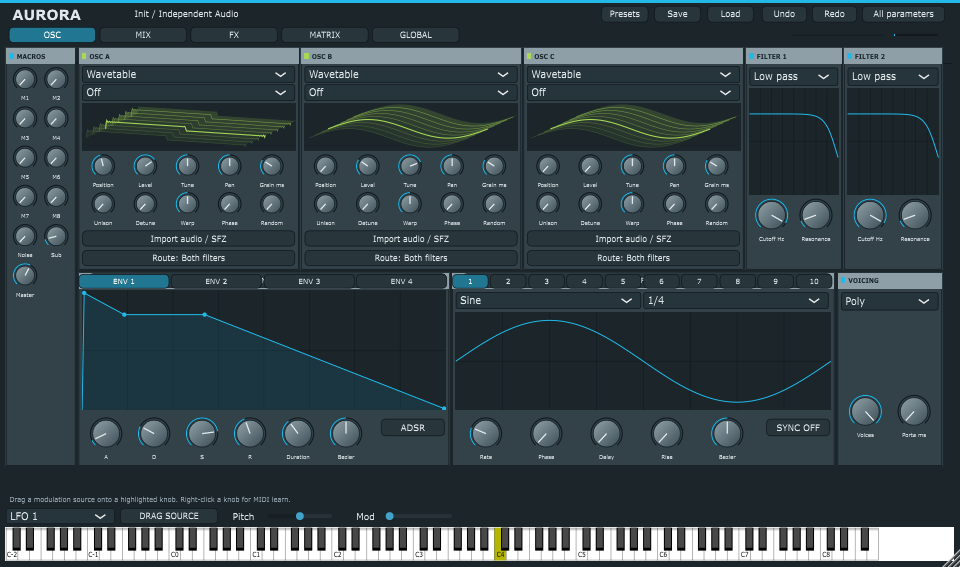

# Aurora

**Sintetizador e processador de efeitos VST3 de código aberto para Windows x64.**

Aurora combina três osciladores com motores selecionáveis, modulação por envelopes e LFOs, racks de efeitos e uma interface com visualização OpenGL. O projeto inclui o instrumento **Aurora**, o efeito estéreo **Aurora FX** e um aplicativo **Standalone**.

[Baixar versão 0.1.2](https://github.com/GGSantoDa019/Aurora/releases/tag/v0.1.2) · [Reportar problema](https://github.com/GGSantoDa019/Aurora/issues) · [Licença](LICENSE.txt)



## Downloads

Na [página da release](https://github.com/GGSantoDa019/Aurora/releases/tag/v0.1.2):

| Arquivo | Conteúdo |
| --- | --- |
| `Aurora-0.1.2-Windows-x64.zip` | Aurora VST3, Aurora FX VST3, aplicativo Standalone, demonstração e documentação |
| `Aurora-0.1.2-Source.zip` | Código C++, JUCE e Zstandard incluídos |
| `Aurora-0.1.2-SHA256SUMS.txt` | Checksums SHA-256 dos dois pacotes |

A versão 0.1.2 é uma versão inicial experimental. Os binários disponíveis foram compilados e validados em Windows x64; outros sistemas não foram validados.

## Instalação

1. Extraia o pacote Windows. Feche a DAW antes de atualizar.
2. Copie as **pastas completas** `Aurora.vst3` e `Aurora FX.vst3` para uma pasta reconhecida pela sua DAW. A pasta padrão no Windows é `C:\Program Files\Common Files\VST3`; copiar para ela pode exigir privilégios administrativos.
3. Faça uma nova varredura de plugins na DAW.
4. Abra **Aurora** numa pista MIDI ou **Aurora FX** numa pista de áudio.

O pacote inclui `Instalar-Aurora.ps1`, que pode ser executado no PowerShell como administrador. Ele instala os dois VST3 na pasta padrão e preserva a instalação anterior em `Backups` dentro da pasta extraída. No FL Studio, ative **Verify plugins** e **Rescan previously verified plugins** antes de **Find installed plugins**.

Para usar sem DAW, abra `Standalone/Aurora.exe` e configure o dispositivo de áudio. O pacote inclui `Demo.aurora` e `demo.wav`.

## Recursos

| Área | Recursos |
| --- | --- |
| Síntese | Três osciladores, ruído, sub e até 16 vozes; modos Poly, Mono e Legato, portamento, transposição e escala |
| Motores | Wavetable, Sample, Multisample, Granular e Spectral |
| Wavetable | Quatro quadros de 2.048 amostras, oito níveis de limitação harmônica, unison de 1–8 vozes, detune, phase/random e warp Bend/Sync/Fold |
| Importação | WAV, AIFF, FLAC e SFZ básico; samples de até 120 segundos |
| Modulação | Quatro envelopes, dez LFOs, oito macros e 64 rotas; curvas de até oito pontos com tensão Bézier |
| Filtros | Dois filtros SVF com low-pass, band-pass, high-pass e saturação |
| Efeitos | Três racks de quatro slots, com distortion, flanger, phaser, chorus, delay, compressor, reverb, EQ, filtro, Hyper, Bode, convolução, largura, Dimension, mid/side e divisores de bandas |
| Sequenciamento | Arpejador e clip de 16 passos; sync, direção, oitavas e swing |
| Interface | Abas OSC/MIX/FX/MATRIX/GLOBAL, fontes de modulação arrastáveis, MIDI learn, undo/redo, teclado e piano roll |
| Presets | Formato próprio `.aurora`, com samples, zonas e respostas ao impulso incorporados ao estado |
| Visualização | Superfícies sombreadas em perspectiva via OpenGL, com renderização por software para previews e fallback |

## Novidade da versão 0.1.2: importação de SerumPreset

**Load** e o navegador **Presets** aceitam `.SerumPreset` e `.serumpreset` do Serum 2. A tradução é experimental e aproximada: importa parâmetros básicos, wavetables/samples externos, envelopes, LFOs, macros, rotas e parte dos efeitos, com relatório de recursos ausentes. Salve em `.aurora` para incorporar os assets carregados.

Não há equivalência sonora com o Serum. Multisamples SFZ internos, warp/FM e vários recursos avançados não são traduzidos. Veja [o guia de importação e os limites](docs/SERUM_IMPORT.md).

## Correções de interface incluídas desde 0.1.1

- Janela inicial de 960×567; os controles escalam juntos ao redimensionar. As páginas principais cabem na área disponível sem rolagem externa.
- Botão **Route** em cada oscilador da tela OSC: clique para alternar Filter 1, Filter 2, Both filters e Main. MIX continua oferecendo os controles completos de destino e balanço.
- Ao arrastar uma fonte para um knob, aparece uma barra de profundidade assinada abaixo dele. O arco verde indica o intervalo; o popup/tooltip mostra Depth, Min e Max. O valor base do knob e a profundidade definem os extremos. Cada knob exibe uma rota por vez; ao arrastar, seleciona a rota criada ou já existente para aquela fonte. Use MATRIX para editar as demais.
- A profundidade inicial aponta para baixo quando o valor base já está alto, evitando que uma modulação positiva fique inaudível por atingir o limite do parâmetro.
- Removido o splash/logo JUCE da interface; os avisos de licença permanecem nos arquivos do projeto.
- Teste de áudio confirma roteamento para filtro, envelope sobre cutoff e LFO sobre nível. As faixas exibidas são limites da rota selecionada; não representam a soma de todas as rotas nem um medidor instantâneo da modulação.

## Primeiros passos

- **OSC:** escolha o motor de cada oscilador e importe samples ou SFZ. Unison, detune e warp atuam no motor Wavetable.
- **MIX:** ajuste níveis, balanço, destinos e sends. Os buses FX 1 e 2 são paralelos; o rack 3 processa a soma principal.
- **FX:** escolha os efeitos e arraste cabeçalhos para reorganizar slots no mesmo rack. `Import IR` carrega uma resposta ao impulso de até 10 segundos e 32 MB; os slots de convolução do rack compartilham essa IR.
- **MATRIX:** configure source, target, amount e curve das rotas. Também é possível arrastar uma fonte ENV/LFO, ou `DRAG SOURCE`, para um controle compatível em OSC.
- **Curvas:** arraste pontos; use clique direito para remover pontos internos e duplo clique para inserir pontos quando houver espaço. O botão ADSR/CURVE alterna o modo do envelope.
- **GLOBAL:** configure performance, arpejo e clip.
- **Presets:** use `Save` e `Load` para arquivos `.aurora`. Clique direito num knob para MIDI learn.

## Compilação

Dependências incluídas no repositório:

- JUCE **7.0.12**;
- Zstandard **1.5.7**.

Requer CMake **3.22 ou posterior** e compilador C++17. Os binários da release foram compilados com **LLVM-MinGW/Clang 22.1.8** e Ninja. Há um pequeno ajuste no JUCE incluído para remover um construtor legado incompatível com esse compilador; consulte [THIRD_PARTY.md](THIRD_PARTY.md).

No PowerShell, com Git instalado:

```powershell
git clone https://github.com/GGSantoDa019/Aurora.git
cd Aurora
```

Com LLVM-MinGW, informe uma pasta que disponibilize `clang`, `clang++`, `cmake` e `ninja`:

```powershell
.\build.ps1 -ToolchainBin 'C:\caminho\toolchain\bin'
```

Ou configure manualmente com as ferramentas no PATH:

```powershell
cmake -S . -B build -G Ninja -DCMAKE_BUILD_TYPE=Release -DCMAKE_C_COMPILER=clang -DCMAKE_CXX_COMPILER=clang++
cmake --build build --target Aurora_VST3 AuroraFX_VST3 Aurora_Standalone AuroraTests --parallel 3
```

O projeto também pode ser configurado com CMake em um Developer PowerShell para MSVC, mas essa configuração não foi validada nesta release. Os artefatos ficam em `build/Aurora_artefacts` e `build/AuroraFX_artefacts`.

## Validação

O [relatório da release](validation.txt) registra **53 verificações aprovadas**, incluindo DSP, estabilidade dos efeitos, MIDI, presets, UI, Mono/Legato, compilação de shader num contexto OpenGL nativo e carregamento/reprodução dos dois plugins num host VST3 de testes.

Para executar os testes após uma compilação Release com Ninja, a partir da raiz do projeto:

```powershell
New-Item -ItemType Directory -Force work | Out-Null
& '.\build\AuroraTests_artefacts\Release\AuroraTests.exe' `
  "$PWD\build\Aurora_artefacts\Release\VST3\Aurora.vst3" `
  "$PWD\build\AuroraFX_artefacts\Release\VST3\Aurora FX.vst3"
```

Os testes geram arquivos de demonstração e imagens em `outputs/Aurora`. Os caminhos podem variar com o gerador CMake escolhido. O host de testes não substitui a validação na sua DAW.

## Limitações conhecidas

- Os algoritmos e assets são próprios. Existe importação experimental e parcial de SerumPreset/XferJson; não há equivalência sonora demonstrada com outros sintetizadores.
- Sample, Granular e Spectral são motores básicos. SFZ suporta um subconjunto de opcodes; Spectral analisa um quadro, sem sequência espectral completa. Não há time-stretch avançado ou editor completo de zonas.
- Curvas de envelope modulam um gate ADSR; a release desse gate controla o fim da voz. Delay/rise dos LFOs usam o relógio global, sem envelopes independentes por voz.
- Parâmetros do host e LFOs são atualizados por bloco. Não há MPE completo nem garantia de automação por amostra ou resultados idênticos entre tamanhos de bloco.
- EQ, compressor, Bode e divisores são implementações próprias ou simplificadas. Os divisores recombinam bandas, sem sub-racks independentes por banda; reverb e convolução usam JUCE.
- Importar ou restaurar assets interrompe as vozes durante a troca. O navegador de presets ainda não oferece catálogo com tags e favoritos.
- Roteamento de filtros é acíclico. Sends paralelos e efeitos podem elevar o nível do Aurora FX.

## Contribuições

Sugestões e correções são bem-vindas via [Issues](https://github.com/GGSantoDa019/Aurora/issues) e pull requests. Para relatar um problema, informe versão do Aurora, Windows, DAW, taxa de amostragem, tamanho do buffer e passos para reproduzir. Envie apenas samples e presets que você tenha direito de compartilhar.

## Licença

O código Aurora é distribuído sob **GPL-3.0-or-later**. Consulte [LICENSE.txt](LICENSE.txt) e o [texto completo da GNU GPLv3](https://www.gnu.org/licenses/gpl-3.0.html). JUCE, Zstandard, SDK VST3 e runtimes mantêm seus próprios avisos e condições, preservados no repositório e descritos em [THIRD_PARTY.md](THIRD_PARTY.md).
